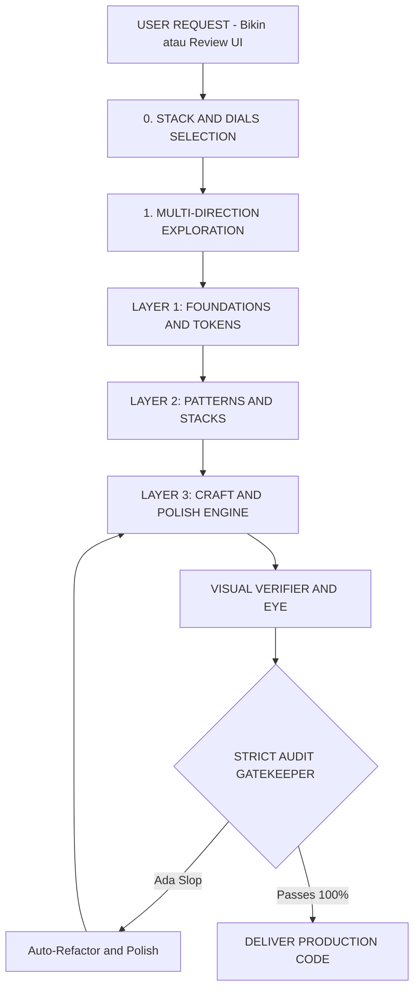

# Frontend Design Mastery (Unified Hybrid Design Engine)

> **The Definitive Frontend Design Engineering System & AI-Slop Enforcer.**  
> Synthesizing world-class intelligence from `ui-ux-pro-max`, `taste-skill`, `impeccable`, `oil-ui`, `claude-design-system`, and `frontend-design-toolkit`.

---

## 🏛️ Topologi Arsitektur & Alur Kerja Sistem



```text
┌─────────────────────────────────────────────────────────────────────────────┐
│                       DETAIL ALUR PROSES ARSITEKTUR                         │
└─────────────────────────────────────────────────────────────────────────────┘
  [USER REQUEST]
        │
        ▼
  [0. STACK & DIALS SELECTION] ─────────► Framework: Next.js / Vue / Svelte
        │                                Dials: Radius, Density, Depth, Motion
        ▼
  [1. MULTI-DIRECTION EXPLORATION] ─────► [1] Radical Minimalist
        │                                [2] Structured Telemetry
        │                                [3] Expressive Humanist
        ▼
  [LAYER 1: FOUNDATIONS] ───────────────► 4px Rhythm, Modular Scale, HSL Colors
        │                                Token Lock: design-system/MASTER.md
        ▼
  [LAYER 2: PATTERNS & SYSTEMS] ────────► 67 Styles, 96 Palettes, 13 Stacks
        │                                Slot Pattern, Figma-to-Code Mapping
        ▼
  [LAYER 3: CRAFT & POLISH] ────────────► Spring Physics (mass, stiffness, damping)
        │                                5-State Architecture (Anti-CLS Skeleton)
        │                                Micro-Copywriting & Action Verbs
        │                                Mobile Thumb-Zone (Bottom 40%)
        ▼
  [VISUAL VERIFIER] ────────────────────► Headless Browser & Viewport 375px Check
        │                                Overflow & Hitbox Inspection
        ▼
  [STRICT GATEKEEPER] ──────────────────► taste-blacklist.csv (Anti-Slop Check)
        │                                WCAG 2.2 AAA A11y (Focus Trap Check)
        │                                Core Web Vitals (Zero-CLS & INP Guard)
        │
   [Passes 100%]
        ▼
  [DELIVER PRODUCTION CODE]
```

---

## 🛠️ CLI Hub Command Reference (`fdm` / `orchestrate.py`)

Anda dapat menjalankan perintah terpusat melalui terminal:

| Perintah CLI | Fungsi |
| :--- | :--- |
| `.\fdm dials` | Menampilkan 5 slider kendali rasa (*Radius, Density, Depth, Contrast, Motion*). |
| `.\fdm explore "<query>"` | Menghasilkan **3 arah visual kontras** (*Minimalist, Structured Telemetry, Expressive*). |
| `.\fdm persist "<query>" -p "Nama"` | Mengunci sistem desain ke file permanen `design-system/MASTER.md`. |
| `.\fdm audit --severity CRITICAL` | Memeriksa pelanggaran anti-slop paling fatal. |
| `.\fdm a11y` | Menjalankan checklist audit aksesibilitas deterministik (WCAG 2.2 AAA & Focus-trap). |
| `.\fdm vitals` | Menjalankan checklist verifikasi Core Web Vitals (Anti-CLS, INP, LCP). |

---

## 💬 Katalog Prompt Lengkap (Cara Pakai Per Fitur)

Salin prompt di bawah ini langsung ke chat agent untuk memicu fitur spesifik:

### 1. Memulai Proyek Baru dengan Penentuan Stack & Dials
> *"Saya mau buat aplikasi dashboard analitik. Sebelum mulai menulis kode, tolong tanyakan stack yang cocok dan berikan pilihan Aesthetic Dials (Radius, Density, Surface Depth) agar saya bisa tentukan gayanya."*

### 2. Multi-Direction Exploration (3 Variasi Desain Side-by-Side)
> *"Saya mau mendesain ulang Hero Section untuk SaaS developer tools. Gunakan fitur Multi-Direction Exploration untuk memberikan 3 variasi konsep visual yang kontras (Minimalist, Structured Telemetry, dan Expressive) sebelum kita mulai coding."*

### 3. Mengunci Desain Permanen (Token & System Persistence)
> *"Kunci sistem desain yang kita sepakati ini ke dalam `design-system/MASTER.md`. Pastikan semua palet warna, tipografi, dan token spasi tersimpan permanen agar halaman berikutnya tetap konsisten."*

### 4. Menghasilkan Komponen dengan Micro-Interactions & Spring Physics
> *"Buatkan komponen Modal Dialog interaktif menggunakan React dan Tailwind CSS. Terapkan spring physics (bukan linear transition), animasi exit 30% lebih cepat, dan blur backdrop yang elegan."*

### 5. Memaksa Penulisan Micro-Copy Berkualitas (Anti-Cliché)
> *"Review semua tombol dan teks di komponen ini. Ganti semua kata klise seperti 'Get Started', 'Learn More', dan 'Submit' dengan action-verbs bervolume tinggi sesuai panduan micro-copy writing."*

### 6. Menangani 5-State Architecture & Edge Cases
> *"Desain komponen Card Profil Pengguna ini dengan Mandatory 5-State Rule: berikan Loading Skeleton (tanpa CLS), Empty State dengan 1 CTA, Error Fallback dengan tombol Retry, Partial/Truncated State untuk nama sepanjang 80 karakter, dan Ideal State."*

### 7. Optimasi Mobile Ergonomics & Thumb Zone
> *"Ubah komponen form multi-step ini agar ramah mobile: posisikan tombol submit primer di Thumb-Zone (40% bawah layar), ubah modal menjadi swipeable bottom-sheet di layar < 768px, dan tambahkan atribut `inputmode='decimal'` serta `autocomplete`."*

### 8. Audit Anti-AI-Slop (Pemeriksaan Kualitas Rasa)
> *"Audit kode komponen ini menggunakan taste-blacklist dan craft-heuristics. Periksa apakah ada warna gradasi murahan, padding ganjil, tombol tanpa cursor-pointer, atau masalah optical alignment pada ikon."*

### 9. Audit Aksesibilitas Deterministik (WCAG 2.2 AAA)
> *"Jalankan audit aksesibilitas pada modal ini: pastikan ada focus-trap keyboard (Tab tidak boleh tembus ke background), tombol Escape menutup modal, dan toast notifikasi menggunakan `aria-live='polite'`."*

### 10. Audit Core Web Vitals & Zero-CLS
> *"Periksa performa rendering komponen hero ini: pastikan semua media memiliki `aspect-ratio` eksplisit, font dideklarasikan dengan `font-display: swap`, dan tidak ada animasi CSS yang menyentuh properti layout (`width`/`height`)."*
